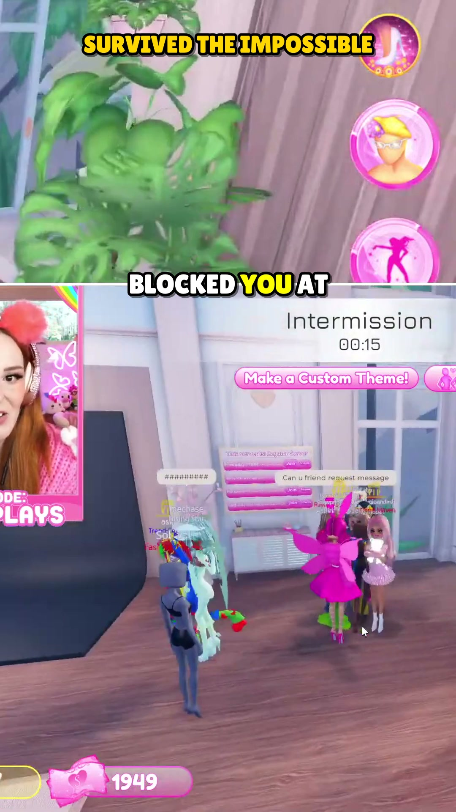
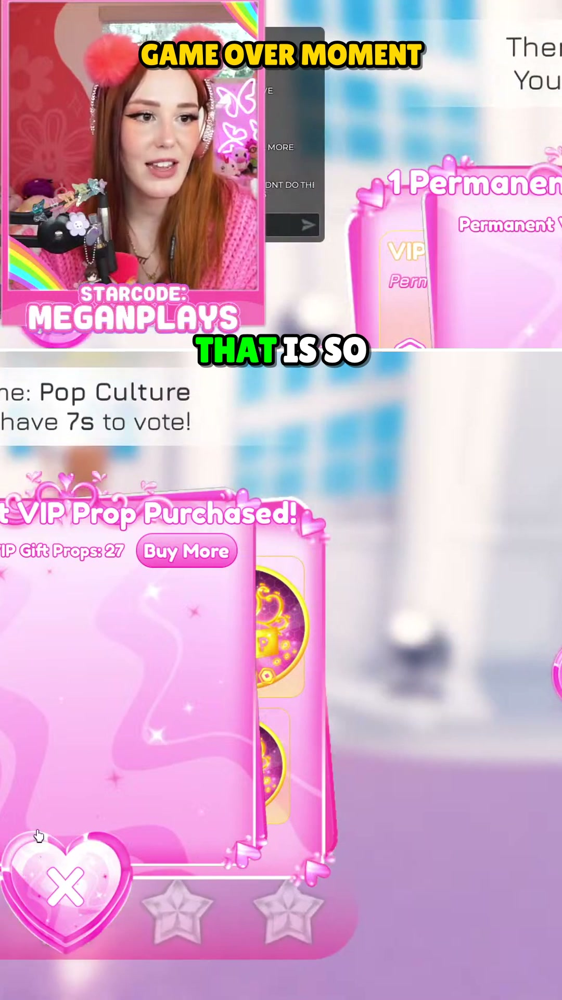
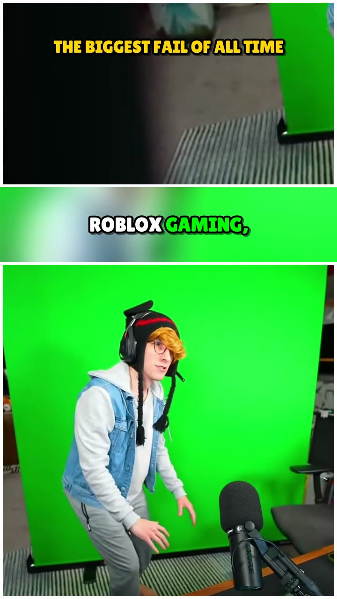
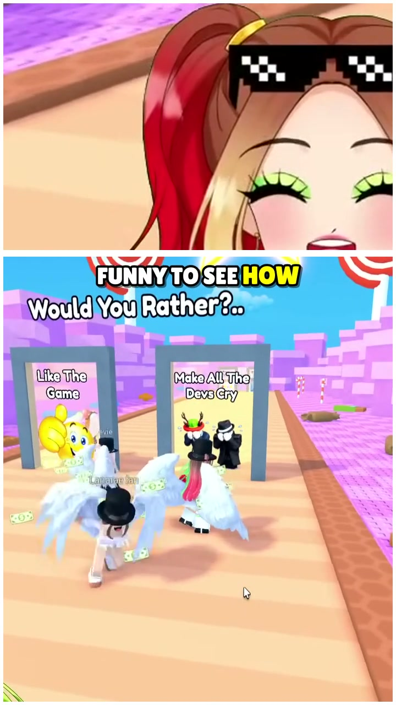
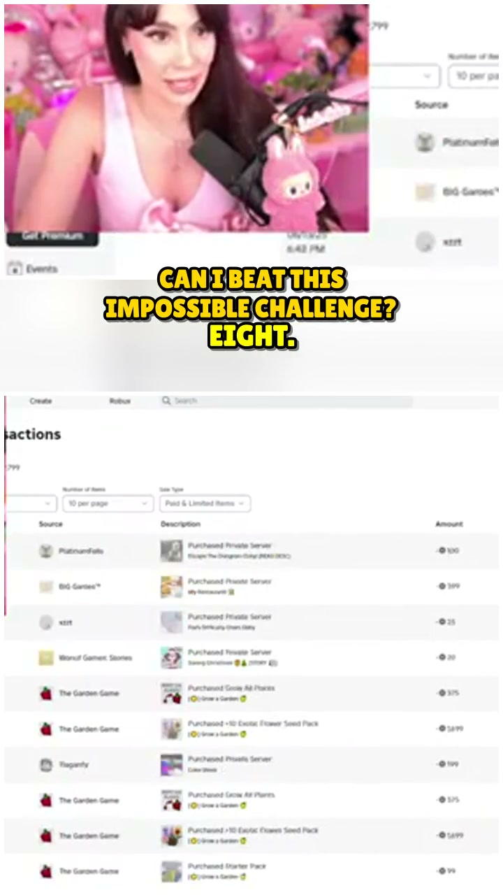

# 🎮 Roblox YouTube Shorts Generator — Autonomous Vision & AI Editing Engine

<div align="center">

[](https://python.org)
[](https://opencv.org)
[](https://n8n.io)
[](https://ai.google.dev)
[](https://developers.google.com/youtube/v3)
[](LICENSE)

**An end-to-end automated pipeline transforming raw Roblox gameplay footage into viral, vertical 9:16 YouTube Shorts with smart facecam cropping, AI narrative pacing, and hands-free publishing.**

[Architecture](#-architecture) • [Core Components](#-core-components) • [Quick Start](#-quick-start) • [Vision Detection](#-vision--facecam-engine) • [Workflow Deployment](#-workflow-deployment)

</div>

---

## 📖 Overview

Creating engaging YouTube Shorts from long-form gaming streams requires tedious manual framing: tracking the creator's webcam, detecting funny reactions or jumpscares, re-cropping 16:9 gameplay to vertical 9:16, generating catchy voiceovers, and rendering burn-in subtitles.

**Roblox YouTube Shorts Generator** automates the entire lifecycle:
1. Ingests raw Roblox session footage.
2. Uses **YuNet ONNX** and OpenCV to locate the creator's facecam box with sub-pixel precision.
3. Automatically composes vertical split-screen layouts (top: reaction facecam, bottom: action gameplay).
4. Employs multimodal AI (Google Gemini) to craft high-retention hooks and viral commentary.
5. Uploads and schedules directly to YouTube with optimized titles, descriptions, and tags.

---

## 🎬 Generated Roblox YouTube Shorts Showcase

<div align="center">

### 1. Vertical Split-Screen & Dynamic Reaction Cropping
<p align="center">
  
  &nbsp;&nbsp;&nbsp;&nbsp;
  
</p>

*Real vertical 9:16 (1080x1920) outputs generated by the pipeline: Sub-pixel YuNet ONNX facecam tracking on the top half, action-centered Roblox gameplay on the bottom, and animated karaoke burn-in captions.*

---

### 2. Viral Gameplay Shorts Gallery
<p align="center">
  
  
  
</p>

*Batch automated renders featuring dynamic sound effects, pacing retention hooks, and YouTube Data API v3 auto-publishing.*

</div>

---

## ⚙️ Core Components

| Component | File | Description |
|:----------|:-----|:------------|
| **Camera & Facecam Detector** | [`cam_detector.py`](cam_detector.py) | Hybrid OpenCV + YuNet ONNX face tracker that extracts webcam coordinates, aspect ratios, and visual cuts from gameplay. |
| **Vision Test Suite** | [`tests/test_vision.py`](tests/test_vision.py) | Comprehensive test harness asserting facecam boundary extraction across multiple resolutions. |
| **Viral Shorts Orchestrator** | [`workflows/transcript_viral_shorts_engine.workflow.ts`](workflows/transcript_viral_shorts_engine.workflow.ts) | Declarative TypeScript n8n workflow coordinating frame extraction, AI scripting, and publishing. |
| **Bypassed Debug Pipeline** | [`workflows/workflow_bypassed.ts`](workflows/workflow_bypassed.ts) | Streamlined workflow variant allowing local offline validation without external API rate limits. |
| **Package Declarations** | [`package.json`](package.json) | Manages `n8n-as-code` dependencies and compilation targets. |

---

## 🚀 Quick Start

### 1. Prerequisites
- **Python**: 3.10+
- **Node.js**: 18+
- **FFmpeg**: Must be available on system `PATH`
- **n8n**: 1.0+ (`npm install -g n8n` or Docker)

### 2. Python Setup

```bash
# Clone the repository
git clone https://github.com/Maliksouhildev/roblox-yt-generator-.git
cd roblox-yt-generator-

# Install Python dependencies
pip install opencv-python opencv-contrib-python numpy requests
```

### 3. Environment Configuration

Copy `.env.example` to `.env` and fill in your keys:

```bash
cp .env.example .env
```

```ini
GEMINI_API_KEY=AIzaSy...
YOUTUBE_CLIENT_ID=your_youtube_client_id
YOUTUBE_CLIENT_SECRET=your_youtube_client_secret
```

### 4. Run the Vision Detector

Test the camera detection on a sample gameplay frame:

```bash
python cam_detector.py --input sample_gameplay.mp4 --output-config cam_config.json
```

Run test suite:

```bash
python tests/test_vision.py
```

---

## 🎬 Vision & Facecam Engine

`cam_detector.py` uses a multi-tier detection cascade:

1. **Local YuNet Inference**: Runs ultra-fast face detection (<10ms per frame) on CPU to locate the gamer in corners.
2. **Temporal Smoothing**: Applies a moving-average filter over 30 consecutive frames to prevent jitter and erroneous crops.
3. **Multimodal Fallback**: If lighting is dark or the creator uses a VTuber avatar, the frame is sent to **Google Gemini 2.5 Flash** with spatial coordinates extraction prompts.
4. **Layout Composition**: Produces clean JSON geometry:
   ```json
   {
     "facecam_detected": true,
     "bbox": {"x": 1420, "y": 40, "width": 460, "height": 320},
     "target_layout": "split_vertical_9_16"
   }
   ```

---

## 🔄 Workflow Deployment (n8n)

### Option A: Using n8n-as-code CLI
```bash
npm install
npx n8nac push
```

### Option B: Direct Import in n8n UI
1. Open n8n at `http://localhost:5678`.
2. Navigate to **Workflows → Import from File**.
3. Select `workflows/workflow.json` or `workflows/transcript_viral_shorts_engine.json`.
4. Configure your YouTube OAuth credentials and Gemini API credentials in the n8n credentials vault.

---

## 🤝 Contributing & License

Contributions, bug reports, and pull requests are warmly welcomed.

Distributed under the **MIT License**. Created & maintained by [Maliksouhildev](https://github.com/Maliksouhildev).
